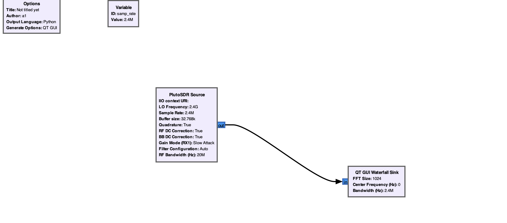
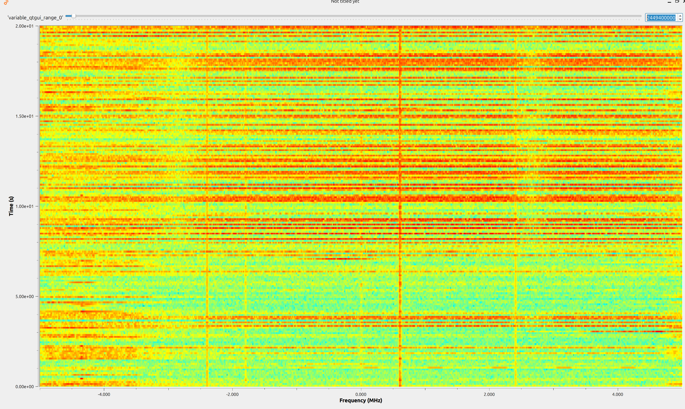
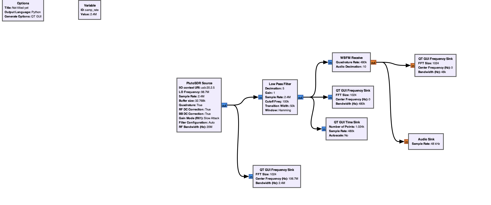

  
Федеральное государственное образовательное бюджетное
учреждение высшего образования 
«Сибирский государственный университет телекоммуникаций и
информатики» (ФГОБУ ВО «СибГУТИ»)

  <h1 style="font-size: 36px; margin-top: 40px;">Отчет SDR №1</h1>
  
Исследование возможностей среды GNU Radio Companion при работе с SDR-платформой ADALM-PLUTO. Спектральный анализ сигналов и разработка широковещательного ЧМ-приемника (WBFM).

  
<b>Выполнил:</b> Студент / Рудометов Д. Р. ИКС-433

  
<b>Проверил:</b> Преподаватель / Калачиков Александр Александрович

  
Новосибирск — 2026

---

#### Часть 1. Спектральный анализ радиоэфира в диапазоне 2.4 ГГц

Для проведения мониторинга радиоэфира в среде GNU Radio Companion был собран граф спектрального анализатора с выводом водопада (Waterfall Sink).

В схеме задействованы следующие блоки:
* **Options:** базовые параметры проекта (генерация графического интерфейса на базе QT GUI).
* **Variable (`samp_rate`):** частота дискретизации задана равной $2.4\text{ Мвыб/с}$ (`2.4M`).
* **PlutoSDR Source:** блок захвата квадратурных отсчетов с трансивера ADALM-PLUTO:
  * Несущая частота гетеродина (`LO Frequency`): $2.4\text{ ГГц}$ (`2.4G`);
  * Частота дискретизации (`Sample Rate`): $2.4\text{ МГц}$;
  * Размер буфера (`Buffer size`): $32.768\text{ кБ}$;
  * Режим АРУ (`Gain Mode (RX1)`): `Slow Attack`;
  * Входная полоса РЧ-фильтра (`RF Bandwidth`): $20\text{ МГц}$.
* **QT GUI Waterfall Sink:** блок построения спектрограммы во временной области:
  * Размер БПФ (`FFT Size`): $1024$;
  * Полоса обзора (`Bandwidth`): $2.4\text{ МГц}$.

Сформированная блок-схема представлена на рисунке ниже:

После запуска графа было открыто графическое окно с визуализацией спектрально-временной диаграммы в диапазоне частот около $2.45\text{ ГГц}$ (с возможностью оперативной перестройки частоты ползунком `variable_qtgui_range_0`):

---

#### Часть 2. Разработка широковещательного ЧМ-приемника (WBFM)

На втором этапе в GNU Radio Companion был спроектирован полноценный супергетеродинный квадратурный ЧМ-приемник коммерческого вещательного диапазона (FM broadcast) с настройкой на радиостанцию с несущей частотой $98.7\text{ МГц}$.

Схема приемника включает следующие функциональные узлы:
1. **Источник сигнала PlutoSDR Source:**
   * Подключение к устройству по аппаратному адресу URI: `usb:20.2.5`;
   * Частота настройки гетеродина (`LO Frequency`): $98.7\text{ МГц}$ (`98.7M`);
   * Частота дискретизации (`Sample Rate`): $2.4\text{ Мвыб/с}$;
   * Размер входного буфера: $32.768\text{ кБ}$.
2. **Контрольный спектроанализатор входного сигнала (`QT GUI Frequency Sink`):**
   * Отображение спектра входного радиочастотного сигнала в полосе $2.4\text{ МГц}$ (размер БПФ: 1024).
3. **Фильтр нижних частот (`Low Pass Filter`):**
   * Выделение полосы целевой радиостанции и подавление соседних каналов;
   * Коэффициент децимации (`Decimation`): $5$ (частота понижается с $2.4\text{ МГц}$ до $480\text{ кГц}$);
   * Коэффициент усиления (`Gain`): $1$;
   * Частота среза (`Cutoff Freq`): $100\text{ кГц}$ (соответствует ширине спектра одной ЧМ-станции);
   * Ширина переходной зоны (`Transition Width`): $50\text{ кГц}$;
   * Тип весового окна: окно Хэмминга (`Hamming Window`).
4. **Квадратурный ЧМ-демодулятор (`WBFM Receive`):**
   * Входная квадратурная скорость (`Quadrature Rate`): $480\text{ кГц}$;
   * Аудио-децимация (`Audio Decimation`): $10$ (понижение частоты до $48\text{ кГц}$).
5. **Вывод звука (`Audio Sink`):**
   * Выдача демодулированного звукового потока на стандартную аудиокарту с частотой дискретизации $48\text{ кГц}$ (`48 kHz`).
6. **Контрольно-измерительные блоки визуализации:**
   * `QT GUI Time Sink` — осциллограмма сигнала промежуточной частоты после ФНЧ (Sample Rate: $480\text{ кГц}$);
   * `QT GUI Frequency Sink` — спектр сигнала после ФНЧ (полоса $480\text{ кГц}$);
   * `QT GUI Frequency Sink` — спектр демодулированного аудиосигнала (полоса $48\text{ кГц}$).

Полная блочная схема ЧМ-приемника в среде GNU Radio Companion представлена на рисунке:

