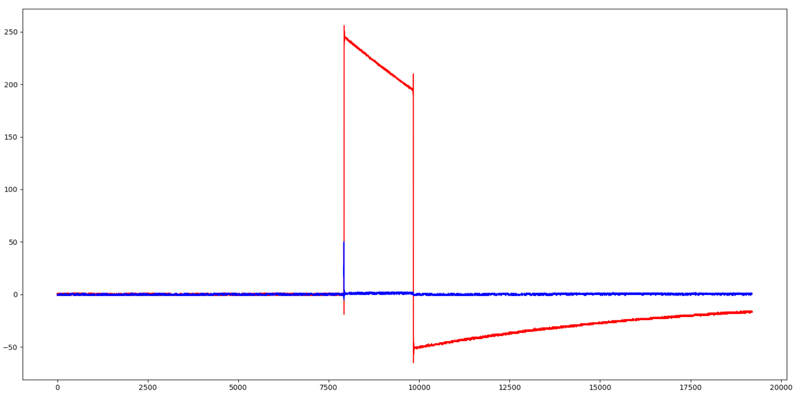

<div style="text-align: center; margin-top: 150px; margin-bottom: 250px;">
  <p style="font-size: 14px; text-transform: uppercase; letter-spacing: 2px;">Федеральное государственное образовательное бюджетное
учреждение высшего образования<br>
«Сибирский государственный университет телекоммуникаций и
информатики» (ФГОБУ ВО «СибГУТИ»)</p>
  <h1 style="font-size: 36px; margin-top: 40px;">Отчет SDR №2</h1>
  <p style="font-size: 18px; color: gray;">Знакомство с библиотеками Soapy SDR, Libiio для работы с Adalm Pluto SDR. Инициализация SDR-устройства. Работа с буфером: получение цифровых IQ-отсчетов.</p>
</div>

<div style="text-align: right; margin-right: 50px;">
  <p><b>Выполнил:</b> Студент / Рудометов Д. Р. ИКС-433</p>
  <p><b>Проверил:</b> Преподаватель / Калачиков Александр Александрович</p>
</div>

<div style="text-align: center; margin-top: 150px;">
  <p>Новосибирск — 2026</p>
</div>

<div style="page-break-after: always;"></div>

---

### Цель работы

* Изучение принципов работы с программно-определяемым радио (SDR) **ADALM-PLUTO** с использованием интерфейса библиотеки **SoapySDR** и подсистемы **Libiio**.
* Инициализация и аппаратная настройка трансивера (несущие частоты передачи и приема, частота дискретизации, коэффициенты усиления трактов TX и RX).
* Освоение потокового механизма приема и передачи данных в формате комплексных 16-битных целых чисел (`SOAPY_SDR_CS16`).
* Формирование тестового сигнала во временной области, реализация циклической пакетной передачи (burst mode) с временной синхронизацией по меткам (`SOAPY_SDR_HAS_TIME`).
* Запись принятых квадратурных отсчетов в бинарный файл данных (`.pcm`) и их последующая визуализация, анализ формы импульса и переходных процессов в среде **Python** с использованием библиотек `numpy` и `matplotlib`.

---

### Выполнение работы

#### 1. Подготовка окружения и сборка проекта

Для взаимодействия с радиочастотным трактом Pluto SDR были установлены и сконфигурированы библиотеки низкоуровневого управления:
* **Libiio** — библиотека взаимодействия с подсистемой Industrial I/O ядра Linux;
* **LibAD9361-iio** — библиотека конфигурации радиочастотного чипа Analog Devices AD9361/AD9363;
* **SoapySDR** и модуль драйвера **SoapyPlutoSDR** — абстрактный аппаратно-независимый C/C++ API;
* Инструменты сборки: `cmake`, `gcc/clang`, `make`.

Сборка проекта осуществлялась с помощью **CMake**:

```bash
mkdir build && cd build
cmake ..
make
```

---

#### 2. Конфигурация устройства и потоков данных

В программе на языке Си (`main.c`) реализована структура `AppConfig`, задающая параметры радиочастотного тракта в зависимости от выбранного режима работы:
* **Режим передачи (TX, ключ `0`):** несущая частота TX = 800 МГц, несущая RX = 750 МГц, усиление TX = -40 дБ, усиление RX = 30 дБ;
* **Режим приема (RX, ключ `1`):** несущая частота TX = 750 МГц, несущая RX = 800 МГц, усиление TX = -40 дБ, усиление RX = 30 дБ;
* **Частота дискретизации (Sample Rate):** 1.0 Мвыб/с ($1 \times 10^6$ сэмплов в секунду).

Инициализация устройства и открытие потоков данных формата `CS16` (Complex Signed 16-bit):

```c
// Поиск и инициализация SDR по аппаратному адресу URI
SoapySDRKwargs args = {0};
SoapySDRKwargs_set(&args, "driver", "plutosdr");
SoapySDRKwargs_set(&args, "uri", Config.uri);
SoapySDRKwargs_set(&args, "loopback", "0");

SoapySDRDevice *sdr = SoapySDRDevice_make(&args);
SoapySDRKwargs_clear(&args);

// Установка частот дискретизации, несущих частот и аналогового усиления
SoapySDRDevice_setSampleRate(sdr, SOAPY_SDR_RX, 0, Config.rate);
SoapySDRDevice_setFrequency(sdr, SOAPY_SDR_RX, 0, Config.rx_freq, NULL);
SoapySDRDevice_setGain(sdr, SOAPY_SDR_RX, 0, Config.rx_gain);

SoapySDRDevice_setSampleRate(sdr, SOAPY_SDR_TX, 0, Config.rate);
SoapySDRDevice_setFrequency(sdr, SOAPY_SDR_TX, 0, Config.tx_freq, NULL);
SoapySDRDevice_setGain(sdr, SOAPY_SDR_TX, 0, Config.tx_gain);

// Создание потоков RX и TX
size_t channels[] = {0};
SoapySDRStream *rxStream = SoapySDRDevice_setupStream(
    sdr, SOAPY_SDR_RX, SOAPY_SDR_CS16, channels, 1, NULL);
SoapySDRStream *txStream = SoapySDRDevice_setupStream(
    sdr, SOAPY_SDR_TX, SOAPY_SDR_CS16, channels, 1, NULL);
```

---

#### 3. Формирование сигнала в буфере и пакетная передача

Размер MTU буфера считывается аппаратно через `SoapySDRDevice_getStreamMTU()`. Каждый сэмпл состоит из пары 16-битных целых чисел: четный индекс соответствует синфазной составляющей ($I$), а нечетный — квадратурной ($Q$).

Передача осуществляется в пачечном (пакетном) режиме:
* Полный цикл составляет 20 буферов: **10 буферов пачки (burst)** и **10 буферов паузы (gap)**;
* Внутри пачки сигнал формируется с периодом $T = 1920$ отсчетов (`PERIOD = 1920`), чередуя значения амплитуды ($2000$) между $I$ и $Q$ составляющими;
* В паузе буфер заполняется нулями (`memset(tx_buffer, 0, ...)`):

```c
size_t cycle_pos = buffers_read % TOTAL_CYCLE_BUFFERS;
int is_burst = (cycle_pos < BURST_LENGTH_BUFFERS);

if (is_burst) {
    for (size_t n = 0; n < tx_mtu; ++n) {
        size_t pos = (global_sample_index + n);
        int16_t sample_i, sample_q;

        if (pos < HALF_PERIOD) {
            sample_i = AMPLITUDE;
            sample_q = 0;
        } else {
            sample_i = 0;
            sample_q = AMPLITUDE;
        }

        tx_buffer[2 * n]     = sample_i;
        tx_buffer[2 * n + 1] = sample_q;
    }
} else {
    // Пауза между пачками (заполнение нулями)
    memset(tx_buffer, 0, 2 * tx_mtu * sizeof(int16_t));
}
```

Передача выполняется с опережающей временной меткой на 4 мс (`tx_time = timeNs + 4 * 1000 * 1000LL`) с флагом `SOAPY_SDR_HAS_TIME`, что исключает опустошение аппаратных буферов (underflow). Одновременно принятые отсчеты считываются из `rxStream` и сохраняются в бинарный файл `Rxdata.pcm`:

```c
if (Config.mode == 1 && dump_file)
    fwrite(rx_buffer, sizeof(int16_t) * 2, (size_t)sr, dump_file);
```

Вывод работы программы в терминале:

```text
TX carrier: 750.000 MHz
RX carrier: 800.000 MHz
MTU - TX: 1920, RX: 1920
Start test...
Buffer: 0 - Samples: 1920, Flags: 0, Time: 1729750000000, TimeDiff: 1729750000000
Buffer: 1 - Samples: 1920, Flags: 0, Time: 1729751920000, TimeDiff: 1920000
Buffer: 2 - Samples: 1920, Flags: 0, Time: 1729753840000, TimeDiff: 1920000
...
Buffer: 10 - Samples: 1920, Flags: 0, Time: 1729769200000, TimeDiff: 1920000
...
test complete!
```

---

#### 4. Программа обработки и визуализации в Python (`read.py`)

Для анализа сохраненного бинарного файла `Rxdata.pcm` разработан скрипт на языке Python:

```python
import os
import matplotlib.pyplot as plt
import numpy as np

SCRIPT_DIR = os.path.dirname(os.path.abspath(__file__))
name = os.path.normpath(os.path.join(SCRIPT_DIR, "..", "build", "Rxdata.pcm"))

# Чтение сырых 16-битных целых отсчетов (little-endian int16)
raw = np.fromfile(name, dtype="<i2")

# Деинтерливинг квадратурных компонент
real = raw[0::2].astype(np.float64)  # I (Real)
imag = raw[1::2].astype(np.float64)  # Q (Imag)

n = min(len(real), len(imag))
real = real[:n]
imag = imag[:n]

# Модуль сигнала (огибающая)
amplitude_abs = np.sqrt(real**2 + imag**2)
count = np.arange(n)

# Построение временной диаграммы
plt.figure(figsize=(14, 6))
plt.plot(count[:n], real[:n], color="blue", label="I (Real)", linewidth=1.0)
plt.plot(count[:n], imag[:n], color="red", label="Q (Imag)", linewidth=1.0)
plt.title("Временная диаграмма принятых IQ-отсчетов")
plt.xlabel("Номер сэмпла")
plt.ylabel("Амплитуда (int16)")
plt.grid(True, alpha=0.3)
plt.legend()
plt.tight_layout()
plt.show()
```

---

### Анализ результатов

На рисунке ниже представлен график принятых цифровых IQ-отсчетов во временной области, построенный по записанным данным:



