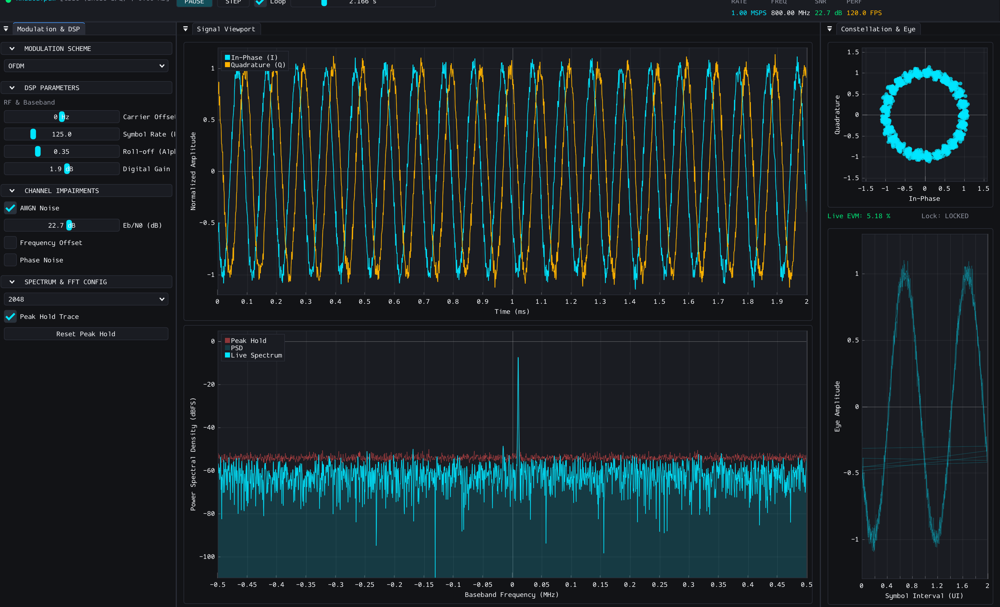

  
Федеральное государственное образовательное бюджетное
учреждение высшего образования 
«Сибирский государственный университет телекоммуникаций и
информатики» (ФГОБУ ВО «СибГУТИ»)

  <h1 style="font-size: 36px; margin-top: 40px;">Отчет SDR №2</h1>
  
Знакомство с библиотеками Soapy SDR, Libiio для работы с Adalm Pluto SDR. Инициализация SDR-устройства. Работа с буфером: получение цифровых IQ-отсчетов.

  
<b>Выполнил:</b> Студент / Рудометов Д. Р. ИКС-433

  
<b>Проверил:</b> Преподаватель / Калачиков Александр Александрович

  
Новосибирск — 2026

---

Переход на плюсы и добавление визуализации через imgui

